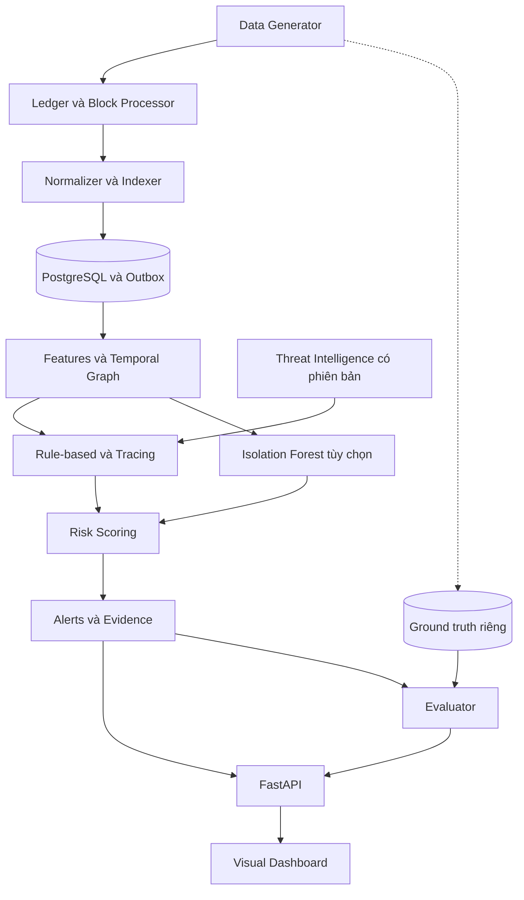
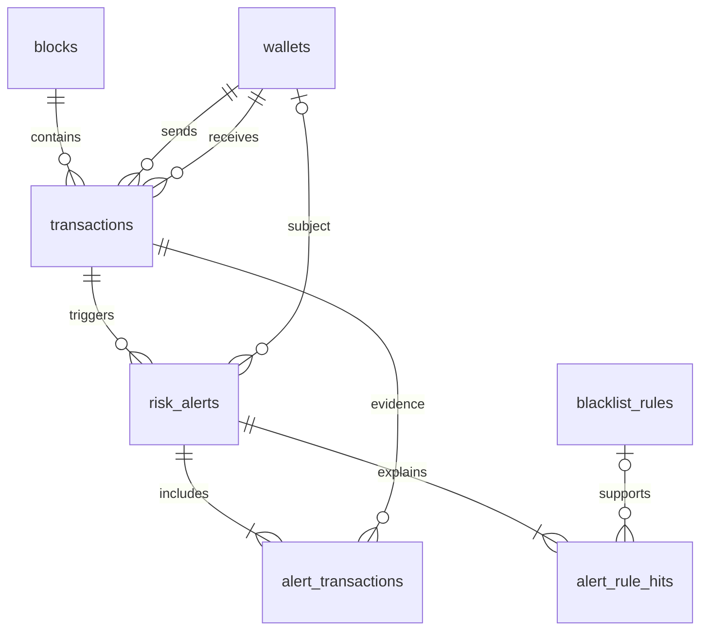

**MÔ PHỎNG CƠ CHẾ CHỐNG RỬA TIỀN TRONG GIAO DỊCH BLOCKCHAIN**

Architecture & Implementation Plan — bản thiết kế đề xuất ngày 08/09/2026.

Mục tiêu: tạo một mạng giao dịch tổng hợp có trạng thái sổ cái hợp lệ; phát hiện dấu hiệu Structuring/Smurfing, Peeling Chain, Mixing và Rapid Movement liên quan địa chỉ rủi ro; giải thích cảnh báo bằng giao dịch và đường đi cụ thể; đo hiệu quả trên dữ liệu có nhãn độc lập. Đây là kế hoạch triển khai, chưa phải hệ thống đã chạy hoặc kết quả benchmark thực nghiệm.

Phạm vi MVP: một mạng account-based, một tài sản giả lập SIM có 6 chữ số thập phân, chỉ chuyển tài sản gốc giữa các địa chỉ. Ngưỡng và điểm trong tài liệu là tham số thí nghiệm do dự án đề xuất. Kết quả là mức ưu tiên xem xét, không phải kết luận pháp lý hoặc xác suất phạm tội. FATF yêu cầu xem chỉ báo trong bối cảnh; sự hiện diện của một chỉ báo chưa đủ để khẳng định hành vi phạm tội. [FATF, Virtual Assets Red Flag Indicators, 2020](https://www.fatf-gafi.org/content/dam/fatf-gafi/reports/Virtual-Assets-Red-Flag-Indicators.pdf.coredownload.pdf).

**1. Kiến trúc hệ thống — System Architecture**

Chọn Python + FastAPI + PostgreSQL + NetworkX + scikit-learn cho phần dữ liệu và phân tích; React + Cytoscape.js cho dashboard; Docker Compose cho môi trường chạy. Tách API và worker thành hai tiến trình dùng chung bộ mã để tác vụ đồ thị không chặn yêu cầu giao diện. Chưa cần Kafka, Neo4j hoặc GNN trong MVP.

| Thành phần | Trách nhiệm và sản phẩm đầu ra |
| --- | --- |
| Scenario Generator | Tạo ví, số dư genesis, nền giao dịch bình thường và các chiến dịch giả lập; xuất transaction intents theo seed |
| Ledger / Block Processor | Kiểm tra balance, nonce, fee; sắp thứ tự; cập nhật sổ cái; đóng block có liên kết hash |
| Normalizer / Indexer | Ghi block và giao dịch đã chấp nhận; chống trùng; tạo sự kiện phân tích trong outbox |
| Feature & Graph Worker | Duy trì cửa sổ thời gian, đồ thị có hướng đa cạnh, trạng thái dòng tiền và feature snapshot |
| AML Engine | Rule-based + temporal graph + Isolation Forest tùy chọn; sinh score, reason codes, evidence và phiên bản |
| Alert Service | Gom cảnh báo cùng vụ việc, quản lý trạng thái xem xét và lưu lịch sử đánh giá |
| FastAPI | API mô phỏng, ví, giao dịch, đồ thị, cảnh báo và benchmark; SSE cho cập nhật tiến độ |
| Dashboard | Điều khiển chạy/replay, khám phá dòng tiền, đọc giải thích, xem kết quả kiểm thử |
| Evaluator | Đọc riêng ground truth, so sánh dự đoán với nhãn và xuất metrics |

Luồng chính và các nhánh dữ liệu:



Một lần xử lý block:

1. Generator tạo intent; Ledger kiểm tra đúng thứ tự và từ chối intent không hợp lệ.
2. Ledger tạo block, cập nhật balances và ghi transactions, block, outbox trong một database transaction.
3. Worker đọc outbox theo `(block_height, tx_index)`, cập nhật trạng thái và tính feature chỉ từ dữ liệu đã quan sát.
4. Engine lưu risk assessment cho giao dịch; khi một mẫu nhiều giao dịch vừa đủ điều kiện, tạo cảnh báo chứa toàn bộ evidence và thời điểm phát hiện.
5. API trả kết quả; dashboard cập nhật qua SSE. Replay dùng lại seed, config và các phiên bản đã khóa.

Outbox dùng cơ chế giao ít nhất một lần; consumer phải idempotent. Khóa xử lý là `(run_id, tx_hash, analysis_version)`. `analysis_version` đại diện tổ hợp rule version, model version, feed snapshot và chế độ phân tích. Checkpoint worker chỉ tiến sau khi assessment và trạng thái xử lý đã ghi thành công. Trạng thái đồ thị trong RAM có thể dựng lại từ ledger/checkpoint, không phải nguồn sự thật duy nhất.

Ethereum sử dụng trạng thái tài khoản và giao dịch có các trường như nonce, value, gas; còn Bitcoin giao dịch tiêu thụ UTXO và tạo các output mới. Vì vậy thiết kế không dùng chung một cặp from/to làm bản ghi gốc cho cả hai mô hình. [Ethereum transactions](https://ethereum.org/developers/docs/transactions/), [Bitcoin transactions](https://developer.bitcoin.org/devguide/transactions.html).

Simulator chỉ mô phỏng quy tắc ledger và hash chain. Nó không tái hiện EVM, chữ ký, đồng thuận PoS/PoW hoặc an toàn mạng ngang hàng. Block được coi là final ngay sau khi append trong MVP. Nếu cần trình diễn giao dịch Ethereum thật trên mạng phát triển, bổ sung adapter Hardhat, đọc JSON-RPC transaction + receipt + block để đưa về schema chuẩn; chuyển ETH giữa EOA không yêu cầu viết hợp đồng AML. Hardhat có node phát triển chạy cục bộ. [Hardhat node](https://hardhat.org/docs/guides/hardhat-node).

**2. Cơ chế mô phỏng dữ liệu — Data & Scenario Simulation**

Quy ước: `1 SIM = 1_000_000 base units`; tất cả tiền dùng số nguyên ở Python và `NUMERIC(78,0)` trong PostgreSQL. JSON truyền các số tiền bằng chuỗi để tránh mất chính xác ở JavaScript. Timestamp dùng UTC; thứ tự có ý nghĩa là `(block_height, tx_index)` vì nhiều giao dịch có chung thời gian block.

Ngưỡng thử nghiệm mặc định `T = 1.000 SIM`, tương ứng `1_000_000_000 base units`. Đây là ngưỡng nội bộ của simulator, không đại diện ngưỡng báo cáo của quốc gia hoặc mạng blockchain nào.

Cấu hình khởi tạo nên có `seed=42`, `block_interval_seconds=12`, `max_transactions_per_block=100`, `asset_decimals=6`, `trace_max_hops=5` và `trace_lookback_hours=24`. Đây là nhịp block mô phỏng do dự án chọn. Thời gian trên blockchain được điều khiển bằng đồng hồ giả lập, tách khỏi thời gian máy chạy benchmark. Khi có block đến muộn hoặc sai thứ tự, indexer đệm và chỉ cho worker tiến qua dãy block liên tục; dữ liệu đã phân tích cần sửa phải replay từ checkpoint, không âm thầm chèn vào lịch sử đã chấm điểm.

Schema Transaction chuẩn hóa:

| Trường | Kiểu / ý nghĩa |
| --- | --- |
| `schema_version`, `run_id`, `network_id` | Phiên bản hợp đồng dữ liệu, lần chạy, định danh mạng |
| `tx_hash` | Hash xác định của payload giao dịch; duy nhất trong run |
| `block_hash`, `block_height`, `tx_index` | Block chứa và thứ tự giao dịch |
| `from_address`, `to_address` | Địa chỉ tổng hợp trung tính, không mã hóa nhãn hành vi |
| `asset_id`, `value_base` | Tài sản và lượng chuyển theo đơn vị nhỏ nhất |
| `nonce` | Số thứ tự của tài khoản gửi, tăng khi giao dịch được chấp nhận |
| `timestamp`, `observed_at` | Thời gian block và thời gian indexer quan sát, lưu riêng |
| `gas_limit`, `gas_used` | Hạn mức và lượng gas mô phỏng |
| `effective_gas_price_base`, `fee_base` | Giá gas thực dùng; fee = gas_used × effective_gas_price_base |
| `status` | MVP chỉ phát ra `success` cho giao dịch đã nằm trong ledger |
| `hash_scheme` | `sim-sha256-v1`, phân biệt hash mô phỏng với hash Ethereum |

Ví dụ bản ghi; các giá trị đặt trong dấu `<...>` là chỗ thay thế, không phải hash hợp lệ:

```json
{
  "schema_version": 1,
  "run_id": "<run-uuid>",
  "network_id": "sim-account-1",
  "tx_hash": "<64-hex-characters>",
  "block_hash": "<64-hex-characters>",
  "block_height": 120,
  "tx_index": 0,
  "from_address": "sim_a91d6f",
  "to_address": "sim_c25e71",
  "asset_id": "SIM",
  "value_base": "900000000",
  "nonce": 7,
  "timestamp": "2026-09-08T08:24:00Z",
  "observed_at": "2026-09-08T08:24:01Z",
  "gas_limit": 21000,
  "gas_used": 21000,
  "effective_gas_price_base": "1",
  "fee_base": "21000",
  "status": "success",
  "hash_scheme": "sim-sha256-v1"
}
```

Giá trị minh họa là 900 SIM và fee 0,021 SIM. Gas và fee này là cấu hình thí nghiệm; khi dùng adapter Ethereum cần dùng số liệu receipt thực tế, không lấy `gas_limit` hoặc `maxFeePerGas` thay cho chi phí thực đã dùng.

Schema Block:

| Trường | Kiểu / ý nghĩa |
| --- | --- |
| `run_id`, `height` | Khóa duy nhất của block trong lần chạy |
| `block_hash`, `parent_hash` | Hash block hiện tại và block trước; parent null tại genesis |
| `timestamp` | UTC, không giảm so với block trước |
| `tx_count`, `tx_hashes` | Số lượng và danh sách hash theo đúng thứ tự; có thể dựng từ bảng transactions |
| `tx_root` | Merkle root của danh sách giao dịch, thuật toán mô phỏng cố định |
| `state_checksum` | SHA-256 của ledger sau block; không gọi là Ethereum state root |
| `gas_used`, `total_fees_base` | Tổng gas và phí của các giao dịch trong block |
| `finality_mode` | `simulated_final` cho MVP |

Hash giao dịch tính từ canonical JSON của intent đã chuẩn hóa gồm network, sender, recipient, value, nonce và cấu hình gas. Không đưa block_hash, nhãn kịch bản hay risk_score vào hash giao dịch. Hash block tính từ canonical header chứa parent, height, timestamp, tx_root và state_checksum; không chứa chính block_hash. Quy định thứ tự key, encoding UTF-8, biểu diễn số tiền, xử lý cây Merkle có số lá lẻ và root của block rỗng trong `schema_version`.

Mỗi sender phải có `balance >= value + fee`, `value > 0`, nonce khớp giá trị kỳ vọng. Thu fee vào tài khoản hệ thống `fee_sink`; tổng balance kể cả fee_sink phải bằng tổng cung genesis. Fee_sink không tham gia đồ thị chuyển tiền AML thông thường. Intent sai balance/nonce bị từ chối trước khi append và lưu ở log thử nghiệm, không tạo cạnh dòng tiền. Nếu sau này hỗ trợ EVM revert, giao dịch revert vẫn có thể mất fee và nonce nhưng không sinh cạnh chuyển value thành công.

Generator có hai phần tách biệt: tạo nền hợp lệ đa dạng, sau đó chèn các chiến dịch có tham số. Nền gồm P2P, merchant, trả lương, chuyển ví cá nhân, gom tiền dịch vụ và giao dịch nhộn nhịp theo giờ. Số tiền dùng nhiều phân phối; thời gian có nhịp ngày đêm và burst; ví được tái sử dụng và xen giao dịch bình thường. Cả nền lẫn chiến dịch dùng cùng cơ chế địa chỉ, cấp vốn và fee để tránh dấu hiệu giả khiến bài toán quá dễ.

| Kịch bản | Thiết kế sinh dữ liệu đề xuất | Dấu vết cần nhận diện |
| --- | --- | --- |
| Structuring | Một ví gửi 12 giao dịch khoảng 800–990 SIM trong 30 phút; số tiền đều dưới T | Nhiều lần chuyển gần ngưỡng, tổng lượng lớn trong cùng cửa sổ |
| Smurfing | A phân phối cho 12 ví trung gian, mỗi ví chuyển phần lớn số nhận đến B trong 60 phút | Fan-out, trung chuyển ngắn, fan-in về cùng đích; nhiều ví chỉ là ứng viên phối hợp |
| Peeling Chain | A0 có 20.000 SIM; mỗi tầng chi khoảng 8% và chuyển phần còn lại sau 2 fee sang A1, A2…; tạo 6 tầng, mỗi tầng 1–5 phút | Một nhánh tiếp nối giữ phần lớn tiền, nhánh nhỏ lặp lại, số dư còn lại thấp |
| Mixing / Tumbling | 8 ví nạp vào 3 ví trung gian; trung gian giao dịch chéo qua 2–3 tầng rồi rút đến 12 ví; chia lệnh nạp/rút trong 5–30 phút | Many-to-many, fan-in/fan-out, dòng vào và ra gần cân bằng, luân chuyển nhanh |
| Rapid high-risk movement | Nguồn H có bản ghi threat intelligence hợp lệ chuyển qua 4 ví rồi đến D; giữ ở mỗi ví dưới 2 phút; chuyển tiếp phần lớn số nhận | Đường đi có thứ tự thời gian, lưu tiền ngắn và có phơi nhiễm từ nguồn rủi ro |

Ở peeling account-based, một tầng là ít nhất hai giao dịch; không mô tả như một giao dịch có hai output. Với ví đầu 20.000 SIM, khoản nhỏ 1.600 SIM và hai fee 0,021 SIM thì khoản tiếp nối là 18.399,958 SIM. Với mixing, generator phải làm tròn bằng số nguyên, trừ mọi fee và số dư giữ lại; không để tổng rút tự động bằng tổng nạp nếu phí chưa được tài trợ.

Ground truth lưu ở schema hoặc tệp evaluator riêng: `run_id`, `campaign_id`, `pattern_labels[]`, `tx_hashes[]`, `actor_id`, `role`, `onset_order`, `completion_order`. Một giao dịch có thể có nhiều nhãn. Engine không được đọc trường scenario, actor, vai trò thật hoặc nhãn lành tính/độc hại. Thông tin nhận diện dịch vụ, nếu thử nghiệm, phải là nguồn metadata độc lập mà analyst cũng có thể quan sát; không lấy trực tiếp vai trò bí mật của generator.

Tạo biến thể bằng seed, số nhánh, số tầng, lượng tiền, thời gian, tỉ lệ giao dịch nền, mức chồng lấn chiến dịch và tỉ lệ nguồn rủi ro đã biết. Đưa các ca hợp lệ gần giống hình thái vào tập kiểm thử: payroll, treasury sweep, dịch vụ lưu ký và người dùng chuyển nhiều ví. Dữ liệu chỉ dựa trên giao dịch không thể phân biệt chắc chắn hai trường hợp có cùng quan sát nhưng khác mục đích; phải phản ánh giới hạn này trong metrics.

**3. Thuật toán và cơ chế phát hiện — Detection & AML Engine**

Mỗi feature tại giao dịch e chỉ sử dụng cạnh có order không vượt order(e). Cửa sổ dùng thời gian sự kiện, có quy ước biên thống nhất `[t-W, t]`; với giao dịch cùng timestamp vẫn kiểm tra tx_index. Duy trì cửa sổ 5 phút, 30 phút, 60 phút và 24 giờ. Giao dịch mới có thể hoàn thiện một mẫu cũ; khi đó tạo assessment mới với `detected_at` hiện tại, không sửa lịch sử để làm như đã biết sớm hơn.

| Rule code | Điều kiện khởi tạo để triển khai | Evidence và hạn chế |
| --- | --- | --- |
| `STRUCTURING` | Trong 30 phút có ít nhất 8 giao dịch đi từ một ví nằm trong [0,8T; T); tổng các giao dịch đó >= 5T; chúng chiếm >= 70% số giao dịch đi | Lưu count, sum, near-threshold ratio, cửa sổ và tx IDs; cần kiểm tra payroll/batch payment |
| `SMURFING` | Trong 60 phút có >= 8 trung gian trong fan-out/fan-in; ít nhất 70% giá trị được phân bổ từ nguồn đã tìm thấy đường thời gian đến cùng đích trong tối đa 3 hop | Đo theo lượng được phân bổ, không chỉ số đường; không khẳng định nhiều địa chỉ thuộc một người |
| `PEELING` | >= 4 tầng liên tiếp; mỗi tầng trong <= 10 phút; nhánh tiếp nối chiếm 80–99% balance đầu tầng, nhánh nhỏ tổng 1–20%, số dư cuối <= 2% | Tất cả fee được tính; cần quan sát đủ số dư và không có inflow khác làm phép phân bổ không rõ; không mặc định nhánh lớn là ví cùng chủ |
| `MIXING_PATTERN` | Thành phần trung gian có >= 5 nguồn ngoài và >= 5 đích ngoài trong 30 phút, phần lớn giá trị nạp đi qua trung gian rồi rút nhanh, kiểm tra định lượng bên dưới | Chỉ là mẫu many-to-many nghi vấn; dịch vụ gom/chi tiền có thể giống hệt |
| `RAPID_HIGH_RISK` | Đường từ nguồn TI hợp lệ dài >= 3 và <= 5 hop; từng lần giữ tiền <= 2 phút; mỗi lần phân bổ chuyển tiếp >= 80% phần nhận từ đường đang xét | Nguồn high-risk cần severity >= 80/100, confidence >= 0,8; direct blacklist là rule riêng |
| `DIRECT_BLACKLIST` | Sender hoặc recipient khớp chính xác địa chỉ thuộc loại blacklist trong feed áp dụng tại thời điểm phân tích | Lưu rule ID, feed version, direction, confidence và thời gian hiệu lực |

`STRUCTURING` và `SMURFING` là hai biến thể trong cùng nhóm mẫu; không coi việc có nhiều địa chỉ tự nó chứng minh có nhiều người phối hợp. Giao dịch nhỏ thấp xa T còn được kiểm tra bằng topology smurfing, không bị loại khỏi mọi bộ phát hiện chỉ vì không gần T.

Với mixing, chọn candidate từ các ví có nhiều đối tác vào/ra; dựng lân cận 2–3 hop, gom các candidate trùng nhau thành vùng trung gian C. Tính riêng dòng qua biên C; không cộng các cạnh nội bộ nhiều lần. Gọi I là tổng nạp ngoài vào, O là tổng rút ra ngoài, F là tổng fee được trả bởi ví trong C, B0/B1 là số dư C ở đầu/cuối cửa sổ. Điều kiện kiểm tra tính đúng dữ liệu là `B0 + I = B1 + O + F`; đây không phải tín hiệu rửa tiền vì mọi ledger hợp lệ đều phải cân bằng.

Tín hiệu mixing khởi tạo: `I >= 5T`, `O/I` trong [0,85; 1,05], tỷ lệ giá trị nạp được phân bổ đến các lần rút trong 10 phút >= 70%, đồng thời dòng đầu ra trải trên >= 5 đích và entropy chuẩn hóa >= 0,8. Entropy đầu ra `H = -sum(p_i * ln(p_i)) / ln(k)` với k >= 2 và p_i là tỉ trọng giá trị theo đích. Khi k < 2 đặt H = 0. Quy tắc sổ cái là invariant; fan-in/out, thời gian, mức phân tán và lịch sử mới là dấu hiệu hành vi. Các ngưỡng cần hiệu chỉnh bằng validation.

Graph Analysis:

MVP dùng `NetworkX.MultiDiGraph`: node là `(run_id, address)`, mỗi cạnh là một giao dịch, key là tx_hash; thuộc tính chứa value_base, asset_id, timestamp, order và fee. MultiDiGraph giữ được nhiều lần chuyển giữa cùng một cặp ví. Khi tính centrality trên graph gộp, tổng hợp count/value riêng và giữ ánh xạ về từng cạnh gốc. [NetworkX MultiDiGraph](https://networkx.org/documentation/stable/reference/classes/multidigraph.html).

Degree, số đối tác duy nhất và luồng vào/ra phục vụ tạo candidate; betweenness xấp xỉ trên cửa sổ hoặc graph mẫu chỉ là feature phụ. Không dùng centrality cao làm bằng chứng độc lập. Dịch vụ lớn có thể rất trung tâm. Không chạy betweenness toàn mạng sau từng giao dịch.

Truy vết hai hướng: forward từ nguồn đã biết để tìm tiền đi đâu; backward từ giao dịch/ví đang điều tra để tìm tiền đến từ đâu. Đường đi phải đúng thứ tự thời gian; forward yêu cầu order tăng nghiêm ngặt, backward giảm nghiêm ngặt. Mặc định K = 5 hop, lookback = 24 giờ. Cạnh A→B trước khi A nhận tiền rủi ro không phải đường tiếp nối của khoản nhận sau đó.

BFS/DFS dùng tìm ứng viên và đường giải thích. Một BFS chỉ kiểm tra reachability không thể xác định chính xác lượng tiền liên quan. Với account-based, dùng mô hình phân bổ tỉ lệ (haircut) như một giả định phân tích công khai:

- Trước giao dịch, ví u có balance B và lượng nguồn rủi ro được phân bổ L, với 0 <= L <= B.
- Tỉ lệ q = L/B nếu B > 0; giao dịch value v, fee f phân bổ qv cho người nhận và qf cho fee_sink.
- Bên gửi giảm balance v+f và giảm lượng được phân bổ q(v+f); bên nhận tăng v và qv.
- Làm tròn định lượng theo base unit bằng quy tắc xác định, giữ phần dư ở sender để bảo toàn; không cộng trùng những đường cùng mang một phần vốn.

Các phần vốn gắn nguồn phải là các phần rời nhau. Khi thêm một nguồn TI đã xác thực, chỉ gán mới phần chưa được gán trong balance liên quan; không nhân đôi phần đã truy được. Lưu source, hop và mốc thời gian đủ để giải thích, có thể gộp các phần cùng thuộc tính. Tiền ở account không có định danh đồng coin riêng, nên kết quả là mức phơi nhiễm theo mô hình, không khẳng định truy vết chính xác từng đồng. Self-transfer chỉ làm giảm balance bởi fee; vòng lặp không được sinh thêm lượng phơi nhiễm.

Thứ tự triển khai nên là: replay có kiểm soát số dư và phân bổ trước; lớp BFS/DFS dùng lại trạng thái đó để dựng evidence. Với source đã biết nhưng lịch sử đầu kỳ thiếu, đánh dấu coverage chưa đủ. Trạng thái số dư được duy trì qua toàn bộ replay; giới hạn K/lookback giới hạn phân tích và hiển thị đường đi, không được làm mất tiền trong ledger. Đường bị cắt hoặc state thiếu phải trả `coverage=partial`, không diễn giải phần chưa xét thành an toàn.

Thiết lập ngân sách tối đa 20.000 cạnh xét và 100 đường evidence mỗi truy vấn ban đầu; khi hết ngân sách ghi `truncated=true`. BFS cơ bản trên graph tĩnh có thể tuyến tính theo node/edge, nhưng truy vết nhiều trạng thái thời gian và phân bổ dòng tiền có thể đắt hơn nhiều; cần đo thực tế và giới hạn ứng viên.

Threat intelligence chỉ nạp nguồn có `network_id`, address, category, confidence, source reference, known_at, valid_from, valid_to và list_version. Dùng địa chỉ tổng hợp trong đồ án. Phân biệt ví có score cao do engine với nguồn blacklist từ feed: score cao không tự động biến ví thành seed để lan truyền tiếp. Với đánh giá as-known, feed chỉ khả dụng khi `known_at <= as_of`; bản ghi còn phải có hiệu lực tại thời điểm giao dịch. Phân tích hồi cứu với feed mới tạo assessment khác có `analysis_mode=retrospective`.

Một người nhận ít tiền từ nguồn rủi ro không làm mọi khoản của người đó trở thành 100% rủi ro. Giao dịch trực tiếp với blacklist vẫn có cảnh báo riêng, nhưng phơi nhiễm về sau được phân bổ theo tỷ trọng. Chuyển tiền đến địa chỉ blacklist là rủi ro đối tác; không suy diễn rằng mọi nguồn tiền quá khứ của người gửi đến từ địa chỉ đó.

Isolation Forest là bước mở rộng sau baseline rule + graph. Đơn vị feature là wallet-window: log1p(volume), count, unique counterparties, median/std số tiền, khoảng cách thời gian, fan-in/out, near-threshold ratio, balance turnover và tuổi kể từ first_seen. `first_seen` là lúc hệ thống quan sát đầu tiên, không phải thời điểm tạo ví ngoài đời. Không đưa tx_hash, address, scenario_id, ground-truth role hoặc quyết định tương lai vào feature.

Đề xuất bắt đầu với `IsolationForest(n_estimators=200, max_samples=256, contamination='auto', random_state=42)`. Huấn luyện trên train chứa chủ yếu hành vi nền và một mức lẫn nhiễu đã công bố; không coi đây là bộ phân loại rửa tiền có giám sát. Với scikit-learn, `score_samples` càng thấp càng bất thường; contamination không tự đo ra tỉ lệ rửa tiền trong thực tế. [IsolationForest API](https://scikit-learn.org/stable/modules/generated/sklearn.ensemble.IsolationForest.html).

Đổi chiều `z = -score_samples(x)` và chuẩn hóa A = clip((z - q50)/(q99 - q50), 0, 1), trong đó q50/q99 lấy từ phân phối train đã khóa. Nếu q99 = q50, coi phân bố suy biến và đánh dấu model không khả dụng. A là feature mức bất thường, không phải xác suất. Ngưỡng tạo hàng đợi xem xét bất thường riêng được chọn trên validation; không gán tự động nhãn Mixing vì Isolation Forest cho điểm cao. Chỉ cân nhắc GNN sau khi có baseline, dữ liệu đồ thị đủ lớn và thiết kế chia tập thời gian tránh leakage.

Công thức điểm giao dịch:

`R_blend = 100 × (0,35E + 0,30P + 0,15V + 0,10Q + 0,10A)`

Trong đó mọi thành phần nằm trong [0,1]:

| Biến | Định nghĩa |
| --- | --- |
| E | Mức phơi nhiễm có trọng số từ TI và quan hệ đối tác trực tiếp |
| P | max(S, C, M): S là STRUCTURING/SMURFING, C là PEELING, M là MIXING_PATTERN; baseline mỗi biến 0/1 khi toàn bộ điều kiện mẫu đã đủ |
| V | min(1, max(count_out_sender_5m, count_in_recipient_5m)/20) |
| Q | min(1, max(volume_out_sender_24h, volume_in_recipient_24h)/(3T)) |
| A | max(điểm bất thường sender-window, recipient-window), cả hai lấy tại order hiện tại; cửa sổ không đủ lịch sử có cờ coverage riêng |

Lấy max giữa các nhóm mẫu để giảm cộng dồn các biểu hiện chồng lấn. V/Q vẫn có tương quan với mẫu, vì vậy phải kiểm tra ablation và hiệu chỉnh bằng validation. Với mẫu nhiều giao dịch, P được gắn cho giao dịch hoàn thiện mẫu và các assessment hồi cứu của giao dịch evidence, luôn kèm thời điểm phát hiện thực.

Với phần vốn j phân bổ trong giao dịch e, đặt a_j là lượng, c_j = confidence × severity/100 của nguồn, h_j là số hop kể cả giao dịch hiện tại, và delta_j là thời gian từ lần nguồn chuyển ra đến e. Các phần vốn không trùng nhau, sum(a_j) <= value(e). Một công thức phơi nhiễm ban đầu:

`E_flow(e) = min(1, sum[(a_j/value(e)) × c_j × 0,7^(h_j-1) × exp(-delta_j/24h)])`

`E = max(E_flow, E_direct_counterparty)`

Chỉ tính những phần nằm trong phạm vi tracing đã khai báo; ghi coverage cho phần ngoài phạm vi. Hop và time decay là chính sách điểm, không làm thay đổi lượng tiền gốc. Confidence và severity nguồn được lưu tách để analyst thấy nguyên nhân điểm cao/thấp.

Tránh trường hợp một motif đã đủ điều kiện lại không bao giờ vượt ngưỡng do trọng số bị chia nhỏ, sử dụng score floor có reason code:

- Exact blacklist match đã xác thực: floor 95.
- Đủ rule RAPID_HIGH_RISK: floor 80.
- Đủ ít nhất một nhóm mẫu S/C/M: floor 70.
- Nếu không có các điều kiện trên: floor 0.

`R = round_half_up(clip(max(R_blend, các floor áp dụng), 0, 100))`

Ví dụ E=0,8; P=1; V=0,9; Q=0,7; A=0,8 thì R_blend=86,5, làm tròn half-up thành 87; không có direct blacklist nên xếp High. Motif đơn lẻ P=1 và mọi phần còn lại bằng 0 có blend 30 nhưng final 70, đủ tạo cảnh báo kèm bằng chứng hình thái. Ví bình thường chỉ có volume hoặc velocity cao không thể bị kết luận là motif.

| Score | Mức độ và hành vi hệ thống |
| --- | --- |
| 0–29 | Low, lưu assessment |
| 30–49 | Medium, lưu và cho phép lọc theo dõi |
| 50–69 | Elevated, đưa hàng đợi xem xét |
| 70–89 | High, tạo AML alert |
| 90–100 | Critical, ưu tiên xem xét cao nhất |

Khi chưa triển khai ML, đặt A=0 trong phiên bản baseline được khai báo; không chia lại trọng số ngầm. Khi ML đáng lẽ có nhưng lỗi, trả `model_status=unavailable` và `coverage=partial`; không hiển thị như mô hình đã đánh giá bình thường. So sánh baseline/hybrid ở cùng ngân sách cảnh báo hoặc cùng FPR, có ngưỡng validation riêng.

Score 0–100 là độ ưu tiên; score 87 không có nghĩa xác suất rửa tiền 87%. Dashboard chỉ gán nhãn “nghi vấn mẫu…” và cho phép analyst đóng/giữ cảnh báo. Trong MVP, engine giám sát và cảnh báo; không thể hoàn tác hoặc chặn giao dịch đã final. Nếu giảng viên yêu cầu mô phỏng ngăn chặn, thêm cổng policy trước khi intent được phát vào ledger, đánh dấu kết quả riêng là policy decision.

**4. Database Schema & Entity Relationship**

PostgreSQL là nguồn lưu bền vững; NetworkX là cấu trúc phân tích dựng từ database. Mỗi run chỉ có một network/asset trong MVP. Dùng khóa ghép `(run_id, id)` trên thực thể của một run và FK ghép để không lẫn ví/giao dịch giữa các lần mô phỏng. `run_id` tham chiếu `simulation_runs`; bảng đó lưu seed, network_model, asset_id, decimals, config, generator_version, genesis_time, status và created_at.

| Bảng chính | Cột và ràng buộc cốt lõi |
| --- | --- |
| `wallets` | `run_id UUID`, `id UUID`, `address TEXT`, `balance_base NUMERIC(78,0)`, `next_nonce BIGINT`, `first_seen_at TIMESTAMPTZ`, `last_seen_at TIMESTAMPTZ`, `is_system BOOLEAN`; PK(run_id,id), UNIQUE(run_id,address); balance >= 0; risk hiện tại nếu cache phải có assessed_at/version |
| `blocks` | `run_id UUID`, `id UUID`, `height BIGINT`, `block_hash CHAR(64)`, `parent_id UUID NULL`, `timestamp TIMESTAMPTZ`, `tx_root CHAR(64)`, `state_checksum CHAR(64)`, `tx_count INT`, `gas_used BIGINT`, `total_fees_base NUMERIC(78,0)`; PK(run_id,id), UNIQUE(run_id,height), UNIQUE(run_id,block_hash); FK parent cùng run |
| `transactions` | `run_id UUID`, `id UUID`, `tx_hash CHAR(64)`, `block_id UUID`, `tx_index INT`, `from_wallet_id UUID`, `to_wallet_id UUID`, `asset_id TEXT`, `value_base NUMERIC(78,0)`, `nonce BIGINT`, `timestamp TIMESTAMPTZ`, `observed_at TIMESTAMPTZ`, `gas_limit BIGINT`, `gas_used BIGINT`, `effective_gas_price_base NUMERIC(78,0)`, `fee_base NUMERIC(78,0)`, `status TEXT`; PK(run_id,id); FKs cùng run; UNIQUE(run_id,tx_hash), UNIQUE(run_id,block_id,tx_index), UNIQUE(run_id,from_wallet_id,nonce) |
| `risk_alerts` | `run_id UUID`, `id UUID`, `subject_wallet_id UUID NULL`, `trigger_tx_id UUID`, `detector_code TEXT`, `risk_score NUMERIC(5,2)`, `severity TEXT`, `status TEXT`, `reason_codes JSONB`, `feature_snapshot JSONB`, `window_start/end TIMESTAMPTZ`, `detected_at TIMESTAMPTZ`, `analysis_version TEXT`, `dedup_key TEXT`, `coverage TEXT`; PK(run_id,id), UNIQUE(run_id,dedup_key), score BETWEEN 0 AND 100; trigger và subject FK cùng run |
| `blacklist_rules` | `id UUID PK`, `network_id TEXT`, `address TEXT`, `category TEXT`, `severity_score INT`, `confidence NUMERIC(4,3)`, `source_name TEXT`, `source_ref TEXT`, `known_at TIMESTAMPTZ`, `valid_from TIMESTAMPTZ`, `valid_to TIMESTAMPTZ NULL`, `list_version TEXT`, `enabled BOOLEAN`; CHECK severity 0..100, confidence 0..1, valid_to > valid_from; UNIQUE(network_id,address,source_name,list_version) |

`blacklist_rules` giữ địa chỉ và chứng cứ từ threat intelligence, bao gồm danh sách tổng hợp do dự án tạo. Threshold STRUCTURING/PEELING/MIXING lưu ở `rule_configs` hoặc YAML có version; không nhồi tất cả rule hành vi vào một bảng blacklist. Địa chỉ có thể xuất hiện trong feed trước khi xuất hiện trên ledger, do đó không bắt buộc FK từ blacklist_rules sang wallets. Match dùng network_id của run và địa chỉ đã chuẩn hóa; không dùng so khớp gần đúng.

Các bảng hỗ trợ cần thiết:

| Bảng | Mục đích |
| --- | --- |
| `risk_assessments` | Lưu score và component E/P/V/Q/A cho cả giao dịch không tạo alert; key gồm run, tx, analysis_version, as_of_order; lưu feed/model/rule version và analysis_mode |
| `alert_transactions` | Quan hệ nhiều-nhiều giữa alert và tất cả giao dịch evidence; có evidence_role và path_order nếu cần |
| `alert_rule_hits` | Lưu từng rule hit của alert; blacklist_rule_id có thể null cho heuristic; có rule_code, rule_version, observed_value, threshold, source_snapshot |
| `outbox_events`, `worker_checkpoints` | Chống mất công việc giữa lần ghi ledger và phân tích; replay sau khi worker dừng |
| `analyst_reviews` | Lịch sử status, người thực hiện, ghi chú và thời gian; không ghi đè lịch sử engine |

Sơ đồ quan hệ; các khóa và bảng hỗ trợ vận hành được lược bớt để dễ đọc:



Các index chủ lực: `(run_id,from_wallet_id,timestamp)`, `(run_id,to_wallet_id,timestamp)`, `(run_id,block_id,tx_index)`, `(run_id,status,severity,detected_at)` trên alerts và `(network_id,address,known_at)` trên feed. Check dữ liệu thêm: value > 0, fee >= 0, gas_used <= gas_limit, nonce >= 0; fee phải bằng gas_used × effective_gas_price_base trong profile simulator. Tính đúng parent height, timestamp giao dịch khớp block và balance cần validator/transactional logic, không chỉ FK.

Dedup cấp ingest khác dedup cấp cảnh báo. Ingest cùng tx_hash chỉ tạo một giao dịch; alert gom theo `(run_id, detector_code, anchor, episode_id, analysis_version)` và giữ evidence tăng thêm trong cùng episode. Episode đóng sau thời gian im lặng cấu hình; dữ liệu thêm trong episode cập nhật last_detected_at và lịch sử assessment, không tạo vô hạn alert theo từng lần poll.

API và giao diện đề xuất:

| API | Hành vi |
| --- | --- |
| `POST /api/simulations` | Nhận config và seed, trả 202 cùng run_id/job_id |
| `GET /api/simulations/{run_id}` | Tiến độ và config thực dùng |
| `POST /api/simulations/{run_id}/replay` | Tạo analysis run/version mới trên ledger cũ |
| `GET /api/transactions` | Lọc run, ví, thời gian, score; cursor pagination |
| `GET /api/wallets/{id}` | Balance, dòng tiền, assessment và coverage trong run |
| `GET /api/graph` | Nhận run_id, center, hops, thời gian, limit; trả nodes/edges và truncated |
| `GET /api/alerts` và `GET /api/alerts/{id}` | Danh sách cảnh báo và evidence |
| `PATCH /api/alerts/{id}/review` | Chuyển trạng thái kèm nhận xét; tạo analyst_reviews |
| `GET /api/metrics` | Metrics theo run, tập dữ liệu, pattern và model version |
| `GET /api/events` | SSE cập nhật tiến độ, block và alert |

Dashboard có ba màn hình: Simulation Control; Graph Explorer; Alert & Evaluation. Màu node thể hiện risk hiện tại kèm thời điểm; huy hiệu blacklist và role dịch vụ tách riêng. Cạnh hiển thị direction, value, timestamp; click alert làm nổi đường evidence và mở bảng giải thích count/threshold, source, hop, floor và score components. Slider timeline chỉ hiển thị dữ liệu có sẵn đến mốc đã chọn. Giới hạn mặc định 1.000 node/3.000 edge, tải thêm theo vùng để tránh treo giao diện. Cytoscape.js hỗ trợ hiển thị và tương tác đồ thị; thuật toán AML vẫn chạy trong backend. [Cytoscape.js documentation](https://js.cytoscape.org/).

Vai trò người dùng của sản phẩm: Viewer chỉ xem; Analyst review; Admin sửa feed/config. Rule và metadata nhập vào phải được kiểm tra schema, không thực thi expression tùy ý. Lưu audit thay đổi, giới hạn khối lượng truy vấn graph và dùng tham số SQL. Đây là chức năng bảo vệ trực tiếp tính đúng và khả năng truy xét của hệ thống.

**5. Lộ trình triển khai — Implementation Roadmap, Test Cases & Benchmarks**

Đề xuất 6 tuần cho nhóm 3–4 người bán thời gian; nếu làm một mình, có thể kéo dài 8–10 tuần. Đây là ước lượng cần điều chỉnh theo lịch nhóm. Hoàn thành MVP rule + graph trước khi bổ sung ML.

| Phase / tuần | Công việc cụ thể | Điều kiện hoàn thành |
| --- | --- | --- |
| Phase 1 — tuần 1 | Chốt schema/config; tạo Docker Compose, PostgreSQL migration, genesis và ledger validator; canonical hash | Test balance/fee/nonce/hash pass; chạy lại cùng seed cho ledger giống nhau |
| Phase 1 — tuần 2 | Generator nền + 4 nhóm hành vi; ground truth riêng; block indexer, outbox và replay | Một dataset 5.000 tx hợp lệ; không có leakage qua address/hash/role; replay không ghi trùng |
| Phase 2 — tuần 3 | Window features; rules Structuring/Smurfing/Peeling/Mixing/Rapid; unit fixtures và reason codes | Mỗi mẫu có positive, boundary và negative test; lưu evidence đủ xem lại |
| Phase 2 — tuần 4 | Temporal tracing, haircut, feed versioning, score/floors, assessment history; optional Isolation Forest | Giải thích được nguồn/hop/amount; không có future leakage; baseline có metrics trên validation |
| Phase 3 — tuần 5 | FastAPI endpoints, SSE; Simulation Control, Graph Explorer, Alert Review | Demo từ tạo dữ liệu đến click alert xem đủ bằng chứng; query có giới hạn |
| Phase 3 — tuần 6 | End-to-end test, benchmark 100k tx, split/evaluation, ablation; sửa lỗi và hoàn thiện báo cáo | Công bố metrics thực đo, cấu hình máy, seed/version, confusion matrix và giới hạn; demo có thể lặp lại |

Phân công theo module để các thành viên có thể làm độc lập: Data/Ledger; AML/Graph; API/Database; Dashboard/QA. Nếu nhóm 3 người, ghép API/Database với Data/Ledger và chia test theo module. Không xây hai backend Python và Laravel cùng lúc trong MVP vì phát sinh thêm API boundary và vận hành; nếu nhóm đã có Laravel dashboard bắt buộc, giữ AML như Python service và ghi rõ hợp đồng gọi giữa hai dịch vụ.

Bộ test cần triển khai:

| ID | Ca kiểm thử | Kỳ vọng cần assert |
| --- | --- | --- |
| T01 | P2P bình thường, lượng và tần suất thấp | Không có motif/blacklist alert |
| T02 | 8+ lệnh gần dưới T trong 30 phút, đủ tổng và tỷ lệ | STRUCTURING hit, final score >= 70, evidence đúng các lệnh |
| T03 | Lượng T−1 base unit, T, T+1; tại biên cửa sổ | T−1 thuộc nhóm dưới T; T và T+1 không thuộc; thống nhất quy tắc biên thời gian |
| T04 | Fan-out qua 12 ví rồi về cùng B | SMURFING hit; lượng hội tụ tính theo phân bổ, không nhân tiền do nhiều đường |
| T05 | Chuỗi peeling 6 tầng, có đủ 2 fee/tầng | PEELING hit sau khi hoàn tất tầng thứ 4; hiển thị nhánh lớn/nhỏ |
| T06 | Một lần chuyển có nhánh lớn và nhánh nhỏ, hoặc chuỗi dưới 4 tầng | Không đủ rule PEELING |
| T07 | Many-to-many với turnover nhanh, đủ input/output/entropy | MIXING_PATTERN hit; kiểm tra ledger cân bằng cả fee |
| T08 | Payroll không hội tụ; dịch vụ lưu ký có topology giống mixing | Payroll kiểm tra false positive; dịch vụ giống mixing có thể bị cảnh báo; công bố kết quả, không dùng ground truth để tự bỏ qua |
| T09 | Direct sender/recipient trong blacklist hợp lệ | Exact match hit, score >= 95, có source/list version |
| T10 | Địa chỉ cùng chuỗi ký tự trên network khác; feed hết hiệu lực hoặc known_at ở tương lai | Không match trong chế độ as-known; retrospective có assessment riêng |
| T11 | Đường 4 hop, mỗi hop <= 2 phút, nguồn high-risk hợp lệ | RAPID_HIGH_RISK hit, score >= 80, đường tăng order |
| T12 | B→C xảy ra trước A→B có nguồn rủi ro | Không lấy B→C làm đường của tiền đến sau |
| T13 | Giao dịch cùng timestamp block nhưng khác tx_index | Không nhìn giao dịch phía sau trước khi được xử lý |
| T14 | Wallet nhận dust từ blacklist rồi chuyển tiền có nguồn lớn bình thường | Có direct alert cho dust; khoản tiếp nối không bị gán 100% phơi nhiễm chỉ do dust |
| T15 | Vòng A→B→A, self-transfer và các đường hội tụ | Không lặp vô hạn, không tăng tiền/phơi nhiễm ngoài invariant |
| T16 | Thiếu balance, sai nonce, số âm, fee sai; receipt reverted trong adapter mở rộng | Intent sai bị từ chối; revert không tạo cạnh value thành công |
| T17 | Replay trùng, worker dừng giữa ghi ledger và phân tích | Không mất giao dịch cần xử lý, không nhân đôi edge/assessment/alert |
| T18 | Số tiền lớn vượt 2^53, asset khác, địa chỉ có định dạng sai | Không mất độ chính xác; không gộp khác asset; validation báo lỗi rõ |
| T19 | Rule đủ motif nhưng E=A=0; số lượng rất lớn nhưng P=E=0 | Motif vẫn đạt floor 70; volume đơn độc không thành blacklist/motif |
| T20 | Hết ngân sách duyệt graph, lịch sử thiếu, model unavailable | Trả coverage partial/truncated, không báo đã phân tích đầy đủ |
| T21 | Chạy cùng seed/config/version và reanalysis với rule mới | Ledger đầu ra giống nhau; assessment khác version được lưu riêng |
| T22 | Hidden campaign labels/actor IDs đổi nhưng ledger và TI giữ nguyên | Prediction không đổi, chứng minh engine không dùng ground truth |

Tách hai cấp đánh giá: transaction-level và campaign-level. Với transaction-level online, chỉ dự đoán sẵn có tại order đang xét; các giao dịch đầu chuỗi trước khi đủ bằng chứng không được gán hồi cứu để làm đẹp recall. Nếu đánh giá khả năng đánh dấu lại toàn bộ evidence, báo thêm retrospective transaction metrics. Với campaign-level, một alert cùng loại có evidence khớp ít nhất 50% tập giao dịch lõi của một campaign được tính là phát hiện; khóa quy tắc matching trước khi test, ghép một-một và gom duplicate. Ghi onset, thời điểm đủ bằng chứng theo rule và detected_at để phân biệt thời gian cần quan sát với độ trễ xử lý.

Dataset và split:

- D-smoke: khoảng 500 ví / 5.000 giao dịch cho integration test.
- D-standard: khoảng 10.000 ví / 100.000 giao dịch, ít nhất 7 ngày thời gian mô phỏng, nền và chiến dịch xen kẽ.
- D-stress: replay tới 1.000.000 giao dịch; cửa sổ phân tích có giới hạn, không mặc định giữ toàn bộ graph trong RAM.
- Tạo nhiều run độc lập; dùng 60% run để train, 20% validation, 20% test. Seed, địa chỉ, actor, campaign và nhóm biến thể không trùng giữa các split. Cửa sổ của cùng campaign không được nằm ở hai split.
- Trong từng run tính feature theo thời gian; thêm bài đánh giá temporal holdout để kiểm tra thay đổi phân phối. Mọi scaler, quantile và ngưỡng đều fit/chọn trước trên train/validation.
- Tạo bộ test có tỷ lệ giao dịch thuộc chiến dịch 1%, 5% và 10%; thay đổi tỉ lệ nguồn có trong feed 0%, 50%, 100%; công bố cả trường hợp không có blacklist để đo phát hiện cấu trúc.
- Ít nhất 5 seed test; báo trung bình và độ phân tán, bootstrap theo run/campaign để ước lượng khoảng tin cậy vì giao dịch không độc lập.

| Chỉ số | Cách dùng |
| --- | --- |
| Precision = TP/(TP+FP) | Tỉ lệ cảnh báo/giao dịch dự đoán đúng theo đơn vị đang đánh giá |
| Recall = TP/(TP+FN) | Khả năng tìm thấy hành vi đã gán nhãn |
| F1 và macro-F1 theo pattern | Tránh một loại hành vi nhiều mẫu che lấp loại khó |
| FPR = FP/(FP+TN) | Mức gây phiền trên tập giao dịch hoặc cửa sổ lành tính |
| Average Precision trên PR curve | Đánh giá xếp hạng trong dữ liệu lệch lớp; ghi rõ dùng AP, không lẫn với cách tích phân PR-AUC khác |
| Alerts/1.000 tx, duplicate rate | Khối lượng review và hiệu quả gom cảnh báo |
| Detection delay | Báo cả từ onset đến alert và từ thời điểm đủ bằng chứng đến alert |
| Throughput, p50/p95 latency, peak RAM | Tính khả thi vận hành với cấu hình máy đã công bố |

Không dùng accuracy làm bằng chứng chính: nếu 99% giao dịch lành tính, đoán tất cả lành tính vẫn có accuracy 99%. Nếu prevalence p=1%, recall 90% và FPR=1%, precision chỉ khoảng 47,6%. Công thức là `precision = recall × p / (recall × p + FPR × (1-p))`. Vì vậy không đồng thời đặt precision rất cao và cho phép FPR cao trên dữ liệu hiếm hành vi rửa tiền.

Các mục tiêu sau là tiêu chí mong muốn, cần đo mới biết đạt hay chưa:

| Hạng mục | Mục tiêu khởi tạo và điều kiện |
| --- | --- |
| Direct blacklist | Precision/recall 100% trên fixture exact match của feed đã biết và hợp lệ; không suy rộng sang địa chỉ chưa có trong feed |
| Campaign detection | Recall >= 85% cho từng loại trên bộ mô phỏng chuẩn; báo riêng các biến thể khó và khoảng tin cậy |
| Transaction retrospective ở prevalence 1% | Mong muốn recall >= 85%, FPR <= 0,2%, tương ứng precision khoảng >= 81% nếu mẫu số đúng; online metrics báo độc lập |
| Dữ liệu khó | Công bố precision/recall/FPR của payroll, custody và các ca cùng quan sát; không loại chúng khỏi số liệu tổng hợp để đạt mục tiêu |
| Tốc độ | >= 100 tx/s cho rule + graph online ở D-standard trên máy tham chiếu 8 logical CPU / 16 GB RAM |
| Độ trễ alert | p95 <= 2 giây sau khi giao dịch hoàn thiện bằng chứng đã được index; báo riêng thời gian block và thời gian quan sát mẫu |
| Truy vấn dashboard | p95 <= 1 giây với subgraph <= 1.000 node / 3.000 edge, công bố cache nóng/lạnh |
| Tính tái lập | Ledger hash, counts và score xác định khi seed/config/versions cố định; nếu thuật toán lấy mẫu, khóa random_state |

Ablation chạy cùng test split: (B0) chỉ blacklist; (B1) rule cục bộ; (B2) rule + temporal graph; (B3) B2 + Isolation Forest. So sánh ở cùng FPR hoặc cùng số alert/1.000 tx, cả recall từng pattern và latency/RAM. Nếu ML không cải thiện rõ trên unseen runs thì giữ B2 làm sản phẩm chính và báo kết quả trung thực. Đối chiếu mô hình haircut với một giả định phân bổ khác trên một tập fixture nhỏ có thể dùng để trình bày độ nhạy, nhưng không dùng nhãn bí mật để lựa chọn phân bổ khi đang chấm điểm.

Tối ưu sau khi đo bottleneck: index range theo wallet/time; cập nhật feature bằng deque/rolling aggregates; chỉ kiểm tra candidate quanh ví bị ảnh hưởng; centrality chạy theo batch; cache có khóa run/as_of/version; giới hạn graph trả ra frontend. Với NetworkX, dữ liệu lớn cần theo dõi RAM và chi phí object; chỉ cân nhắc storage/engine đồ thị khác sau khi benchmark cho thấy giới hạn thực.

Phần mở rộng UTXO: thêm `tx_inputs(tx_id, vin, prev_tx_hash, prev_vout)` và `tx_outputs(tx_id, vout, address, value_base, spent_by)`. Bắt buộc input tham chiếu output chưa tiêu, một outpoint chỉ tiêu một lần, tổng input = tổng output + fee. Balance được suy ra từ UTXO. Dùng đồ thị hai phía transaction/output hoặc wallet/transaction có giữ liên kết input-output; việc gán chính xác input nào nuôi output nào trong giao dịch nhiều input/output vẫn cần giả định. Change output cũng là output thông thường, không có nhãn sở hữu đặc biệt on-chain. Không tự động gom mọi input thành một chủ thể trong CoinJoin/mixing. [Bitcoin transaction structure](https://developer.bitcoin.org/devguide/transactions.html).

Đầu ra cần bàn giao khi hoàn tất triển khai: source code và lockfile; Docker Compose; migration và data contracts; bộ config/seed cùng generator; rulebook và công thức score có version; test fixtures và test report; file metrics thực đo; demo dashboard; báo cáo kiến trúc, phương pháp, kết quả và giới hạn. Cần khóa lại phạm vi nâng cao: EVM contracts, token/internal transfer, reorg, bridge/cross-chain và GNN là các hạng mục riêng, mỗi hạng mục phải có schema và test bổ sung trước khi tuyên bố hỗ trợ.
