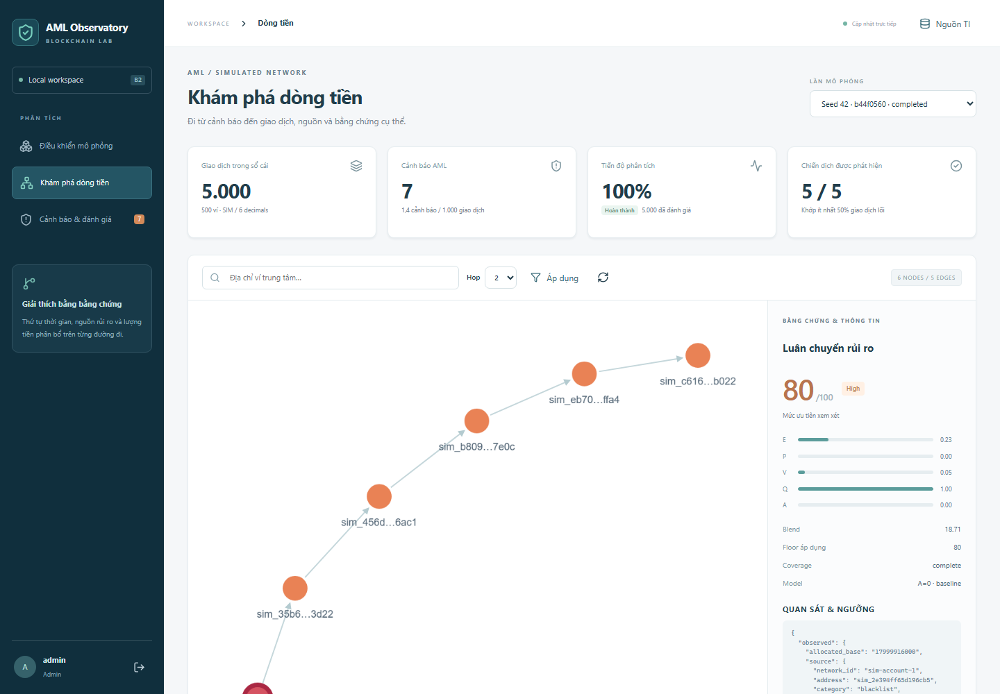

# Kiểm chứng khung local AML — 15/10/2026

Phạm vi bàn giao: baseline B2 chạy local từ generator đến dashboard, với sáu
detector, PostgreSQL bền vững, worker riêng, auth/RBAC, replay và Docker Compose.
Kết quả dưới đây đo trên source hiện tại; không phải báo cáo hoàn thành toàn bộ
roadmap nghiên cứu trong [kế hoạch](../../Ke-hoach-AML-Blockchain.md).

## Môi trường và khả năng tái lập

- Windows / Docker Desktop Linux engine; Docker 29.8.2, Compose v5.6.0.
- Docker VM có 16 logical CPU, khoảng 7,57 GiB RAM; worker giới hạn 2 CPU/2 GiB,
  API 2 CPU/512 MiB. Chưa đo peak RSS hoặc benchmark CPU chuyên biệt.
- Python 3.12.15, PostgreSQL 17, Node.js 24.19.0; dependency theo lockfiles.
- `seed=42`, 500 ví, 5.000 giao dịch, 7 ngày mô phỏng; cả năm campaign bật.
- SIM 6 decimals, `T=1_000_000_000` base units, baseline `A=0`.
- Rule `rules-v1`, feed `synthetic-v1-42`, mode `as-known`.
- Run: `b44f0560-4234-494d-98c8-8bc650057556`.
- Ledger SHA256: `110c5746577dbf7468ba412cfd3ed21b5662ef4c672069a17d04ee148eb96f35`.
- Initial analysis: `b2-rules-v1:2c0cc8f8e320:a1`;
  replay: `b2-rules-v1:425755e14846:a2`.

Run ID và analysis ID được sinh mới khi chạy lại; cùng config/seed tái lập ledger.
[Raw metrics](smoke-metrics.json) lưu kết quả tổng hợp, không chứa credential hoặc
transaction-level ground truth. Kế hoạch gốc giữ nguyên SHA256
`CC05F86162FE13FA53474DCA104ED6147DFCDC2DE75D4C42479136EE7BC86232`.

## Kiểm tra đã chạy

| Lệnh / kiểm tra | Kết quả |
| --- | --- |
| `docker compose up --build -d --wait` | Stack build và khởi động thành công; migration chạy trước API/worker |
| `docker compose config --quiet` | Hợp lệ; không xuất secret đã nội suy |
| `docker compose --profile test run --rm test` | **39 passed** trên PostgreSQL thật, 11,27 giây |
| `docker compose exec -T api ruff check --no-cache app tests` | Passed |
| `npm.cmd test` trong `frontend/` | **4 passed**, gồm BigInt lớn hơn 2^53 và format/parse exact |
| `npm.cmd run build` | TypeScript và Vite build passed |
| `npm.cmd audit --audit-level=high` | 0 vulnerabilities tại thời điểm kiểm tra |
| `npm.cmd run test:e2e` | **1 passed**, 54,1 giây; Chromium của Playwright |
| `node scripts/smoke.mjs --count=5000 --restart-worker` | Passed; sáu reason codes xuất hiện, 5/5 campaign, 7 alerts |
| Tạo lại riêng container API sau khi web đang chạy | `/api/health` qua Nginx phục hồi; không phải khởi động lại web |

Tổng cộng **44 test cases tự động passed**, ngoài API smoke và kiểm tra vận hành.
Backend còn một deprecation warning từ Starlette TestClient dùng httpx; không có
test failure. Ruff dùng `--no-cache` vì app chạy non-root và thư mục source trong
image không cho phép tạo cache. E2E dùng browser riêng, không đọc profile cá nhân;
trace tắt để tránh ghi payload đăng nhập. Chrome cài trên Windows từng treo ở
teardown; cấu hình cuối dùng Chromium do Playwright quản lý và runner đã exit 0.

PostgreSQL tests chỉ reset `aml_test`, không reset `aml`. Integration thử quyền
`aml_app` đọc evaluation schema và xác nhận bị từ chối; thử FK giữa hai run và
xác nhận bị chặn. Crash được tiêm tại giao dịch 110, checkpoint vẫn ở 99; retry
khôi phục đủ 150 giao dịch và không nhân đôi assessment online/outbox.

Smoke kiểm tra 401/403, CSRF, idempotency và conflict 409, pagination không lặp,
money JSON strings, as-of, graph budgets, review revision 409, SSE, replay.
Worker đã khởi động lại giữa ingestion: container được tạo lúc
`2026-10-14T19:42:40Z`, lần start sau lúc `2026-10-14T19:43:04Z`.
Replay giữ nguyên transaction count, ledger hash và wallet balance đã kiểm tra;
analysis version mới, kết quả cũ còn lưu.

E2E đăng nhập API thật, chọn run completed, mở evidence graph có nodes/edges và
canvas thực, lưu review, điều khiển timeline bằng bàn phím, kiểm tra viewport
390×844 không tràn ngang và không có JavaScript error. Ảnh desktop đã kiểm tra
trực tiếp ở dưới; tại cutoff nhỏ graph có thể rỗng đúng semantics.

## Kết quả đo của một run tổng hợp

| Chỉ số | Initial | Replay |
| --- | ---: | ---: |
| Giao dịch / nhãn dương | 5.000 / 95 | 5.000 / 95 |
| Campaign phát hiện | 5/5 | 5/5 |
| Alerts / 1.000 giao dịch | 1,4 | 1,4 |
| Wall time phân tích, gồm persistence | 15,453 giây | 16,285 giây |
| Throughput | 323,558 tx/s | 307,028 tx/s |
| Engine compute p50 / p95 | 0,771 / 2,757 ms | 0,847 / 2,815 ms |
| Assessment có coverage partial | 1.093 | 1.093 |

Thời gian trên là phân tích, không phải tổng thời gian tạo ledger/khởi động/replay
request. p50/p95 chỉ đo engine compute, không phải latency toàn HTTP/worker.
Partial được công khai khi giới hạn provenance/hop/path budget cắt thông tin;
ledger vẫn bảo toàn tiền. Không suy ra đã phân tích đầy đủ từ progress 100%.

| Binary evaluation | TP | FP | FN | TN | Precision | Recall | F1 |
| --- | ---: | ---: | ---: | ---: | ---: | ---: | ---: |
| Online, tại thời điểm từng giao dịch | 22 | 0 | 73 | 4.905 | 1,000 | 0,232 | 0,376 |
| Hồi cứu evidence cuối run | 95 | 0 | 0 | 4.905 | 1,000 | 1,000 | 1,000 |

Online không gán ngược cảnh báo vào giao dịch đã đi qua. Campaign detection yêu
cầu evidence khớp ít nhất 50% core transactions, khác transaction recall online.
Kết quả 1,000 hồi cứu chỉ áp dụng bộ synthetic này, không chứng minh hiệu quả trên
blockchain thật hoặc dữ liệu độc lập. Per-pattern STRUCTURING có 12 FP hồi cứu
(giao dịch thuộc campaign khác); binary FP vẫn 0 vì các giao dịch đó có nhãn
AML dương. Raw metrics giữ riêng hai phép đánh giá để tránh che nhầm detector.

## Truy vết kiểm thử và phần còn lại

Các fixtures ở [domain/AML tests](../../backend/tests/test_domain_aml.py) bao phủ
T01–T16, T18–T22 trong phần baseline liên quan: amount/window boundaries,
motif positives/negatives, temporal order, TI validity/network/known_at,
dust/haircut/full-spend/self-transfer/cycles, conservation, half-up/floors,
budget partial, determinism và hidden metadata không đổi prediction.
Regression bổ sung kiểm allocated forwarding ratio cho rapid và hold time của
peeling. [PostgreSQL/API/worker tests](../../backend/tests/test_postgres_api_worker.py)
bao phủ T17/T21 crash/retry/replay, run isolation, auth và review concurrency.
T18 có domain/parser/BigInt tests; đây không phải kiểm chứng mọi adapter/asset.

Chưa hoàn tất các phần nghiên cứu sau: custody/confounder dataset phong phú của
T08, merchant/payroll/treasury background, nhiều campaign/seed, split 60/20/20,
AP/bootstrap CI, full B0–B3 ablation, benchmark 100k/1m và peak RAM/delay distribution.
Isolation Forest chưa cấu hình; ML outage test T20 và EVM revert test T16 là N/A
cho baseline này. Replay hỗ trợ version/feed/mode; chỉnh rule parameters qua UI
và toàn bộ backward investigation API là bước tiếp theo. Không coi tất cả T01–T22
hoặc toàn bộ Definition of Done nghiên cứu đã đạt.

Database backup/restore thực tế và public deployment chưa kiểm thử; Compose
hiện chỉ bind loopback. Named volume và `.env` giữ lại để tiếp tục dùng local.
Chạy lại theo [README](../../README.md); mọi mở rộng phải giữ các bất biến trong
[AGENTS.md](../../AGENTS.md) và [rules Docker](../../.codex/rules/10-docker-local.md).
